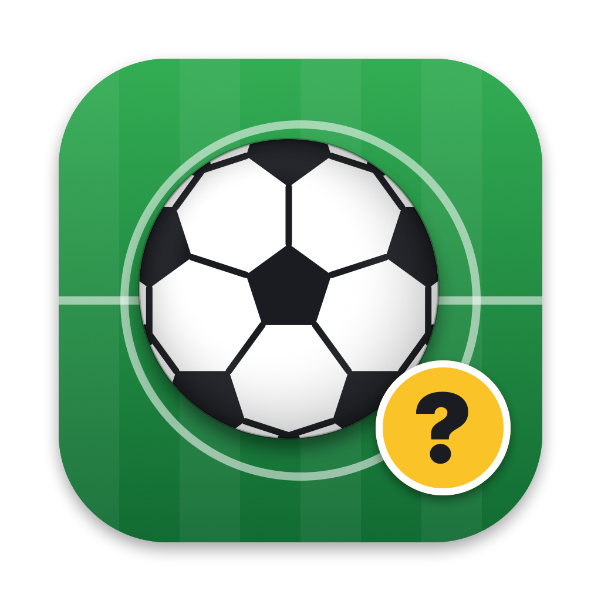
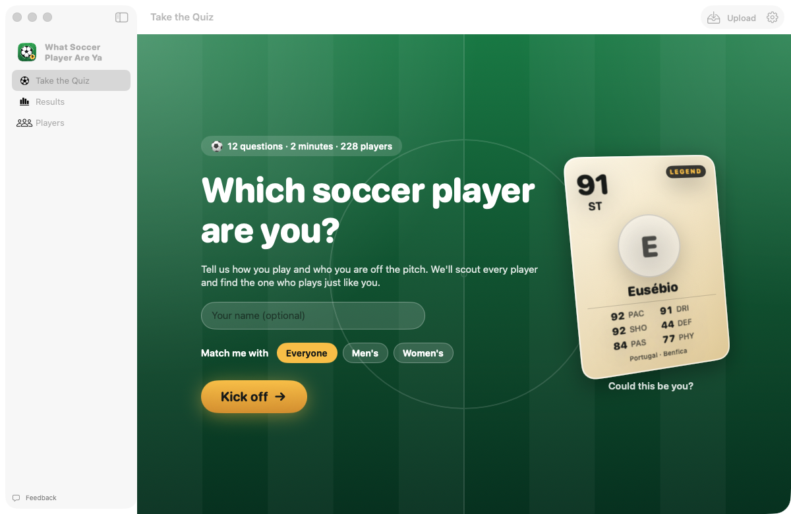
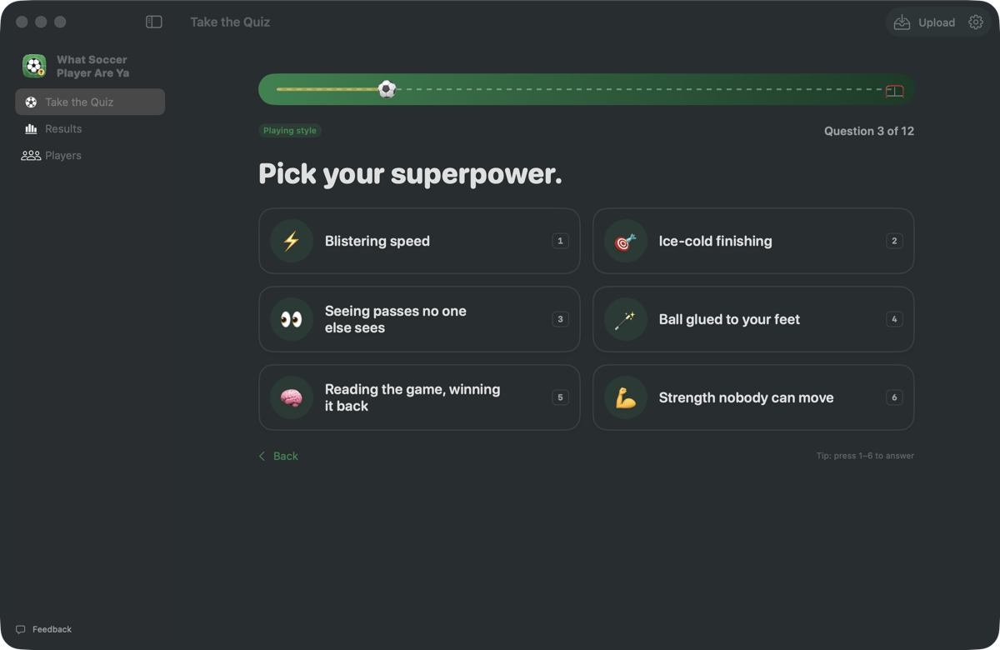
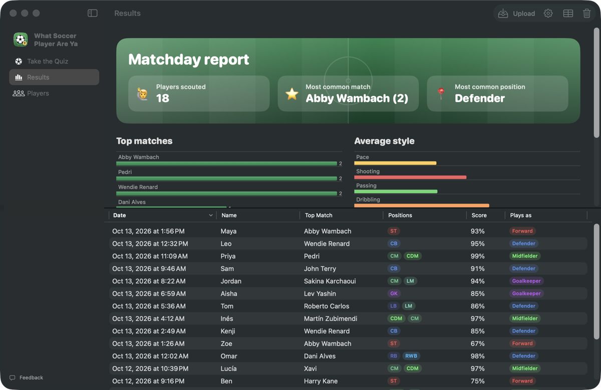
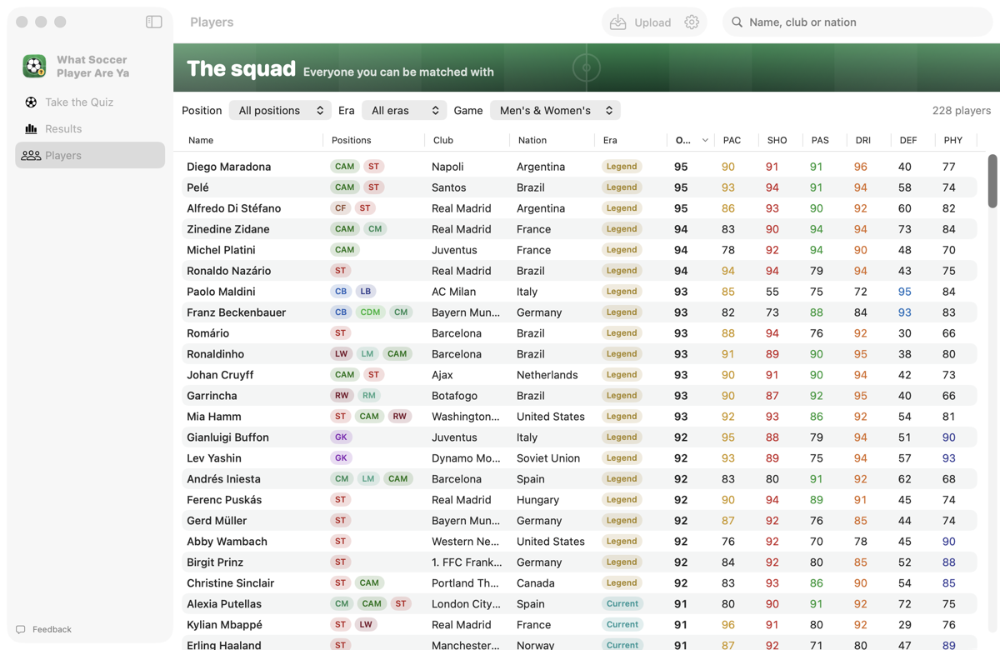
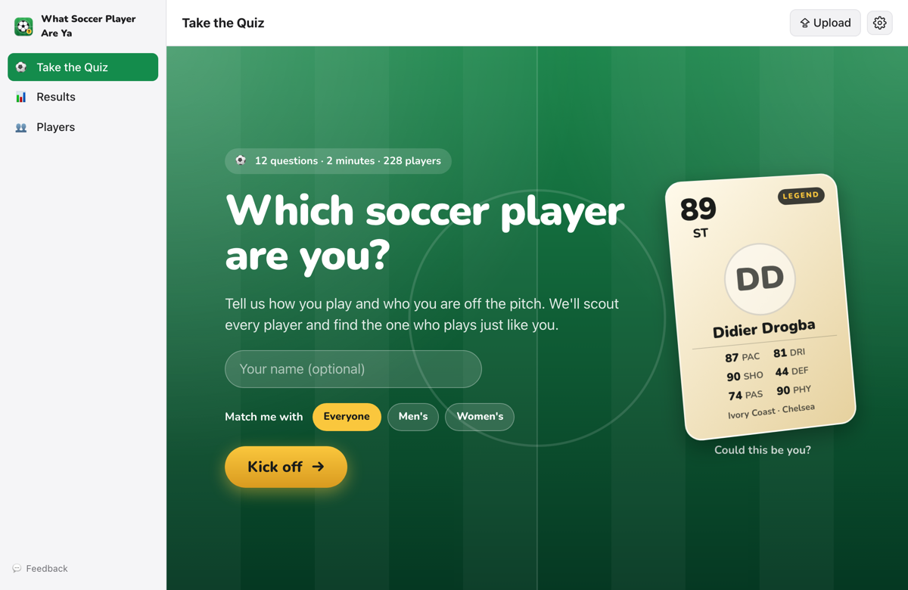
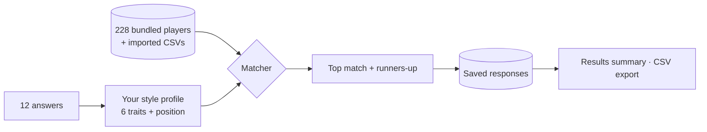

# What Soccer Player Are Ya

A Mac app and website with a 12-question quiz that tells you which soccer player you play like. It saves every response and shows a summary of everyone's answers.

**[Take the quiz on the web →](https://amalmehta.github.io/WhatSoccerPlayerAreYa/)**

| Kick off | Answer 12 questions (dark mode) |
|---|---|
|  |  |

| Everyone's results (dark mode) | The squad |
|---|---|
|  |  |

| The website | On a phone (dark mode) |
|---|---|
|  |  |

- [How to build, run and use it](docs/INSTRUCTIONS.md)
- [System design](docs/SYSTEM-DESIGN.md)
- [What's where](docs/FILE-STRUCTURE.md)
