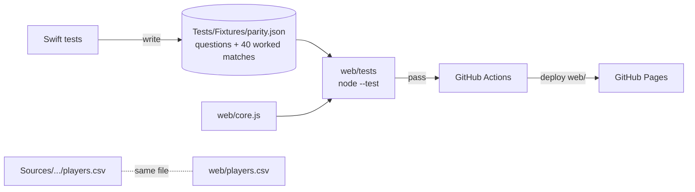

# System Design

What Soccer Player Are Ya is a native SwiftUI Mac app. All of its logic lives in a separate library, **SoccerCore**, that has no UI code and is unit-tested. The app target is a thin SwiftUI layer on top of that library.

## Architecture

```mermaid
flowchart TB
    subgraph App["WhatSoccerPlayerAreYa (SwiftUI app)"]
        CV[ContentView<br/>sidebar · toolbar · drop · ⌘V]
        QV[QuizView + ResultView]
        RV[ResultsView<br/>Swift Charts + table]
        PV[PlayersView]
        SV[SettingsView ⌘,]
        FV[FeedbackView]
        AM[AppModel<br/>@Observable, main actor]
        PAL[Palette<br/>category colours]
    end
    subgraph Core["SoccerCore (library, tested)"]
        CSV[CSVParser]
        IMP[PlayerImporter<br/>+ BundledPlayers]
        QZ[Quiz<br/>questions → Profile]
        MT[Matcher<br/>Profile × Players → Matches]
        RS[ResponseStore<br/>ResponseSummary<br/>ResponseExporter]
    end
    DATA[(players.csv<br/>bundled)]
    DISK[(Application Support<br/>Responses.json<br/>Imported Players.json<br/>Feedback.json)]
    UD[(UserDefaults<br/>settings)]

    CV --> AM
    QV --> AM
    RV --> AM
    PV --> AM
    SV --> AM
    FV --> AM
    QV --> QZ
    AM --> MT
    AM --> IMP --> CSV
    IMP --> DATA
    AM --> RS --> DISK
    AM --> DISK
    SV --> UD
    AM --> UD
```

## Components

| Component | Job |
|---|---|
| `Models.swift` | `Player`, `Gender` (men's or women's game), `Trait` (the six card attributes, and what each one means for a goalkeeper), `PositionGroup` (maps EA position codes to a group) and `Era`. |
| `CSVParser` | A small RFC 4180 reader. It handles quotes, escaped quotes, newlines inside fields, CRLF line endings and a byte-order mark. |
| `PlayerImporter` | Turns CSV rows into players. It maps column-name aliases so both the app's own format and FIFA/EA FC (sofifa/Kaggle) exports work, falls back to `goalkeeping_*` columns for keepers, reads an optional `gender`/`sex` column, skips incomplete rows and removes duplicates. `BundledPlayers` loads `players.csv` from the app bundle first, then from the SwiftPM resource bundle. |
| `Quiz` | Holds the 12 questions: 6 on playing style and 6 on personality. Each answer adds weight to traits and to position groups. `Quiz.profile` turns the answers into a `Profile`: traits min–max scaled to 0–1, plus position shares that sum to 1. |
| `Matcher` | Ranks players against a profile. See *Matching* below. |
| `ResponseStore` | Keeps saved quiz responses in one JSON file, written atomically. |
| `ResponseSummary` | Totals for the Results page: counts of top matches, average traits and position counts. |
| `ResponseExporter` | Writes a CSV export with one column per question and properly escaped fields. |
| `AppModel` | The app's state. It holds the player pool (bundled plus imported), runs the settings-based filter, saves responses, imports files and text, and saves feedback. |
| Views | Quiz flow, result card, Results dashboard, Players table, Settings window and Feedback sheet. |
| `Palette` | Colours for each category, with light and dark variants. See *Colour coding* below. |

## The website

The website in `web/` is a static site with no build step and no server code:

| File | Job |
|---|---|
| `core.js` | A JavaScript port of SoccerCore: CSV parsing, player import, the 12 questions, profiles, matching, summaries and CSV export. |
| `app.js` | The pages (quiz, result, Results, Players), the Settings and Feedback dialogs, importing (Upload button, drop anywhere, paste), keyboard shortcuts and storage. |
| `index.html`, `styles.css` | The page layout and styles: a sidebar on wide screens and a top bar on phones, with light and dark themes. |
| `players.csv`, `icon.png` | Copies of the Mac app's bundled players and icon, made by `scripts/sync-web.sh`. |



**Keeping the two apps in step.** The quiz and matcher exist twice, in Swift and in JavaScript. `ParityTests.swift` writes the questions and 40 worked cases to `Tests/Fixtures/parity.json`. The cases use different answers, all four filters (all players, women's, men's, legends only), the resulting profiles and the top five matches with scores and shared strengths. The JavaScript tests check `core.js` against that file and check that `web/players.csv` is byte-for-byte the Mac app's file. If the Swift side changes without regenerating the fixture, `swift test` fails. If the JavaScript side drifts, the website tests fail, and the deploy is blocked.

**Storage.** Each visitor's responses, imported players, settings and feedback are saved in their own browser under `wspay.*` keys in `localStorage`. Every read and write is wrapped so the site still works when storage is blocked or full. Nothing is sent to a server. The Results page summarises that browser's responses only.

## Main flows

1. **Take the quiz.** The person answers the questions, then:
   1. `Quiz.profile` builds their profile.
   2. `AppModel.rank` passes the current filter to `Matcher.rank`.
   3. The result is saved as a `QuizResponse` in `Responses.json`.
   4. `ResultView` shows the top match, a trait-by-trait comparison and the runners-up.
2. **Import players.** Every input route ends in `AppModel.importFiles` or `importText`, which call `PlayerImporter`, merge the new players with any imported before (same ID means replace), save them to `Imported Players.json`, show a banner and switch to the Players page. The routes are:
   - the Upload button or ⌘O, which opens `fileImporter`
   - a drop anywhere on the window (`onDrop` on the root view, with a full-window highlight)
   - ⌘V, caught by a local key monitor that ignores the key while a text field is focused, which reads file URLs or CSV text from the pasteboard
3. **Review results.** `ResultsView` rebuilds a `ResponseSummary` from all saved responses each time it draws. Deleting rows or clearing everything goes through `ResponseStore`. Export writes the CSV through a save panel.
4. **Choose men's or women's.** One setting (`gender`: All, Men or Women) is shared by the quiz start screen and Settings. `MatchFilter.allows` applies it with the era and rating filters. When it's set to one game, players with no known gender (from imports without the column) are left out. The Players page has its own browse-only picker.
5. **Change settings.** The values live in `UserDefaults` through `@AppStorage`. `AppModel` reads them whenever it ranks players, so a change applies to the next quiz.

## Matching

Each player is described by six numbers (PAC, SHO, PAS, DRI, DEF, PHY) and a position group. A person is described by a six-number trait shape and a position-share distribution. A player's score is:

```
score = 0.60 × shape + 0.35 × position + 0.05 × fame
```

- **shape:** both trait vectors are mean-centred, then compared with cosine similarity, mapped from −1…1 to 0…1. This compares *which traits stand out*, not absolute ratings. Otherwise every quiz would match the highest-rated players.
- **position:** (the person's share for the player's group ÷ their biggest share)². Squaring it makes a clear position preference count. In a 3,000-run random-answer simulation, 86% of top matches came from the person's main position, up from 75% before squaring.
- **fame:** a small bonus for higher overall ratings that mainly breaks ties in favour of well-known players.

**Goalkeepers.** Keeper cards store Diving, Handling, Kicking, Reflexes, Speed and Positioning in the six slots, as EA does. To compare a person with a keeper, their traits are translated first:

| Keeper slot | Taken from |
|---|---|
| Diving | pace |
| Handling | defending |
| Kicking | passing |
| Reflexes | dribbling |
| Speed | pace |
| Positioning | physical |

**Shared strengths.** These are the traits in both the person's top three and the player's top three.

**Variety.** With the default filter (overall 75 or higher), 3,000 random answer sets produced about 145 different top matches out of 228 players.

## Where data lives

| Data | Location | Format |
|---|---|---|
| Bundled players (228: 156 current, 72 legends; 180 men, 48 women, tagged in a `gender` column) | `Sources/SoccerCore/Resources/players.csv`, copied to `Contents/Resources` in the app | CSV |
| Saved responses | `~/Library/Application Support/What Soccer Player Are Ya/Responses.json` | JSON, ISO 8601 dates |
| Imported players | `…/Imported Players.json` | JSON |
| Feedback | `…/Feedback.json` | JSON |
| Settings | `UserDefaults` (`com.amalmehta.WhatSoccerPlayerAreYa`) | plist |
| Website: responses, imports, settings, feedback | the visitor's browser, `localStorage` keys `wspay.responses`, `wspay.imported`, `wspay.settings`, `wspay.feedback` | JSON |

`WSPAY_DATA_DIR` overrides the Application Support folder, which is used for demos and screenshots.

## Colour coding

Related categories share a hue family. Shades within a family are spaced apart in hue, saturation and brightness so they're easy to tell apart. Every colour has a darker version for light mode and a brighter one for dark mode, built with `NSColor(name:dynamicProvider:)`.

**Positions**

| Group | Family | Shades |
|---|---|---|
| Forwards | reds | ST, CF, wingers (LW/RW) |
| Midfielders | greens | CDM, CM, CAM, wide midfielders (LM/RM) |
| Defenders | blues | CB, fullbacks (LB/RB), wing-backs (LWB/RWB) |
| Goalkeepers | purple | |

**Traits**

| Kind | Family | Traits |
|---|---|---|
| Attacking | warm reds, oranges and ambers | shooting, dribbling, pace |
| Build-up | green | passing |
| Defensive | blues | defending, physical |

**Eras:** Current is teal, Legend is gold, Imported is slate.

## Key decisions and trade-offs

- **Bundled dataset plus CSV import, not a scraped third-party dataset.** Bundling a large FIFA dataset raises licensing questions. Instead the app ships 228 players compiled for it and imports any FIFA/EA FC CSV the user brings. *Trade-off:* the bundled ratings are approximations, not official card values.
- **Matching on shape, not ratings.** Quiz answers say what someone is *like*, not how good they are. *Trade-off:* a player with a flat profile (good at everything) is a weaker match for anyone.
- **SwiftPM package with a script that builds the .app, no Xcode project.** It's simple to build from the command line and keeps the repo small. The icon is drawn in code (`scripts/make-icon.swift`) and turned into an `.icns` by the build script. *Trade-off:* ad hoc code signing only, and no asset catalogue.
- **Website as a static port, not shared code.** The site is plain JavaScript with no build step, so it can be hosted for free on GitHub Pages and opened with any web server. *Trade-off:* the logic is written twice, which is why the parity tests exist.
- **Website responses stay in each browser.** No server, no accounts, no personal data collected. *Trade-off:* the Results page can't summarise visitors on different devices.
- **Local-only storage in JSON.** Simple and private. *Trade-off:* no syncing or multi-device survey collection. Responses are only gathered on one Mac.
- **Feedback saved locally, not emailed.** Nothing leaves the machine without the user doing it.
- **The ⌘V import uses an `NSEvent` local monitor** rather than replacing the Paste menu command, so normal pasting into text fields keeps working.

## Testing

`swift test` runs 19 Swift Testing tests in `Tests/SoccerCoreTests`. One of them, `ParityTests`, checks that `Tests/Fixtures/parity.json` is up to date for the website (see above). The rest cover:

- **CSV parsing:** quotes, newlines, byte-order mark and CRLF.
- **Import:** the app's own format, gender column and value aliases, sofifa format with keeper fallback and skipped rows, missing-column errors, and that the bundled dataset loads and covers every position.
- **Quiz:** unique question IDs, profile scaling, an empty quiz, and a JSON round trip.
- **Matching:** striker, playmaker, defender and keeper answers each find the right archetype, plus filters (including men's/women's) and the result limit.
- **Responses:** saving, reloading and deleting, summary counts, and CSV escaping.

**Website:** `node --test web/tests/*.test.mjs` runs 7 tests:

- `web/players.csv` matches the Mac app's file.
- The questions match the Swift ones exactly.
- All 40 parity cases give the same profiles, matches, scores and shared strengths.
- CSV parsing, sofifa import with gender, and missing-column errors.
- Summary counts and CSV export.

The website was also checked by hand in a browser:

- the quiz from start to result, answered with number keys
- importing by paste and by drag-and-drop, including the drop overlay
- ⌘, opening Settings
- the men's/women's setting carrying through to the quiz and Players pages
- feedback being saved
- dark mode
- a 375px phone width with no sideways scrolling

**Checked by hand (Mac app):** the app was launched with demo data, and the Quiz, Result, Results (dark mode) and Players pages were captured and checked visually. The matcher weights were tuned with random-answer simulations.

**Not covered by automated tests:** the views themselves, drag-and-drop and ⌘V import. Their import logic is tested through `PlayerImporter`.

## Known limits

- Bundled ratings are approximate EA FC-style values compiled from memory, and legends are rated at their peak. Clubs reflect summer 2025.
- Imported players without a gender column only appear when matching against both men's and women's players.
- The goalkeeper trait translation is a heuristic.
- Imports read UTF-8 only. Files in other encodings may show garbled accents.
- Very large imports (tens of thousands of rows) load all at once on the main thread.
- The app is ad hoc signed, so other Macs will warn on first open.
- The website can't combine responses from different visitors or devices. Each browser keeps its own.
- Website feedback only reaches the developer if the visitor opens it as a GitHub issue and posts it.
- GitHub Pages needs the repository to be public on a free GitHub plan.
